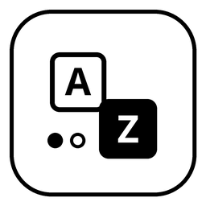
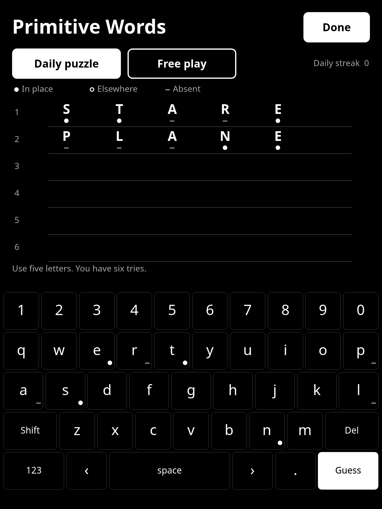
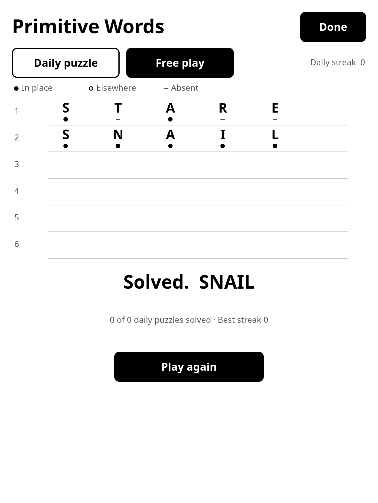

<div align="center">



# Words

**Five-letter puzzles for Kindle**

[](https://github.com/PrimitiveOS/kindle-primitive-words/actions/workflows/ci.yml)
[](https://github.com/PrimitiveOS/kindle-primitive-words/releases)
[](https://github.com/PrimitiveOS/kindle-primitive-words/tags)
[](LICENSE)
[](https://github.com/PrimitiveOS/kindle-primitive-words/stargazers)
[](https://primitiveos.github.io/kindle-primitive-catalog/v1/index.json)

[**Download**](https://github.com/PrimitiveOS/kindle-primitive-words/releases/latest) ·
[**Install guide**](INSTALL.md) ·
[**Changelog**](CHANGELOG.md)

</div>

---

Play a daily five-letter puzzle or start a practice round.

## Quick start

After setting up PrimitiveOS, open **Store** from Primitive Launcher. Choose **Words** under **Apps**,
tap **Get**, and open it from the Launcher grid. The [install guide](INSTALL.md) also covers the standalone USB package.

## Screenshots

<table>
  <tr>
    <td align="center"><br><sub>The daily puzzle</sub></td>
    <td align="center"><br><sub>Dark mode</sub></td>
    <td align="center"><br><sub>Free play solved</sub></td>
  </tr>
</table>

<sub>Desktop simulation at 1264 × 1680 with sample rounds.</sub>

## Highlights

- The daily puzzle changes at midnight UTC, and daily results and streaks are saved separately from Free play.
- The board and keyboard mark letters in black and white.
- A word outside the guess bank leaves the draft and attempt count unchanged.

## Develop locally

Keep `doannt-kindle-tools` and `doannt-kindle-launcher` next to this checkout. The desktop command writes daily puzzle
previews to `build/previews`. The Free play image uses the same renderer with a completed sample round.

```sh
cargo test --offline --locked --workspace
cargo run --offline --locked -p words-desktop -- build/previews
```

## Status

| Device | Status |
|---|---|
| Kindle Oasis 3 (1264 × 1680, firmware 5.18.2) | Tested on hardware |

**Current version: 0.1.1.** Changes are in [CHANGELOG.md](CHANGELOG.md).

## Downloads

The badge at the top shows the number of Store downloads. It counts GitHub downloads of this app's release packages, across all versions and architectures, and is refreshed daily from the [Store catalog](https://primitiveos.github.io/kindle-primitive-catalog/v1/index.json).

## Documentation

[Install guide](INSTALL.md) · [Changelog](CHANGELOG.md) · [Device notes](docs/device-notes.md)

## Licence

Copyright (C) 2026 Doan Nguyen.

App code is licensed under PolyForm Noncommercial 1.0.0. [Code license](LICENSE)

Original documentation and screenshots are licensed under Creative Commons Attribution-NonCommercial-ShareAlike 4.0
International (CC BY-NC-SA 4.0). [Documentation and image license](LICENSE-DOCS)
