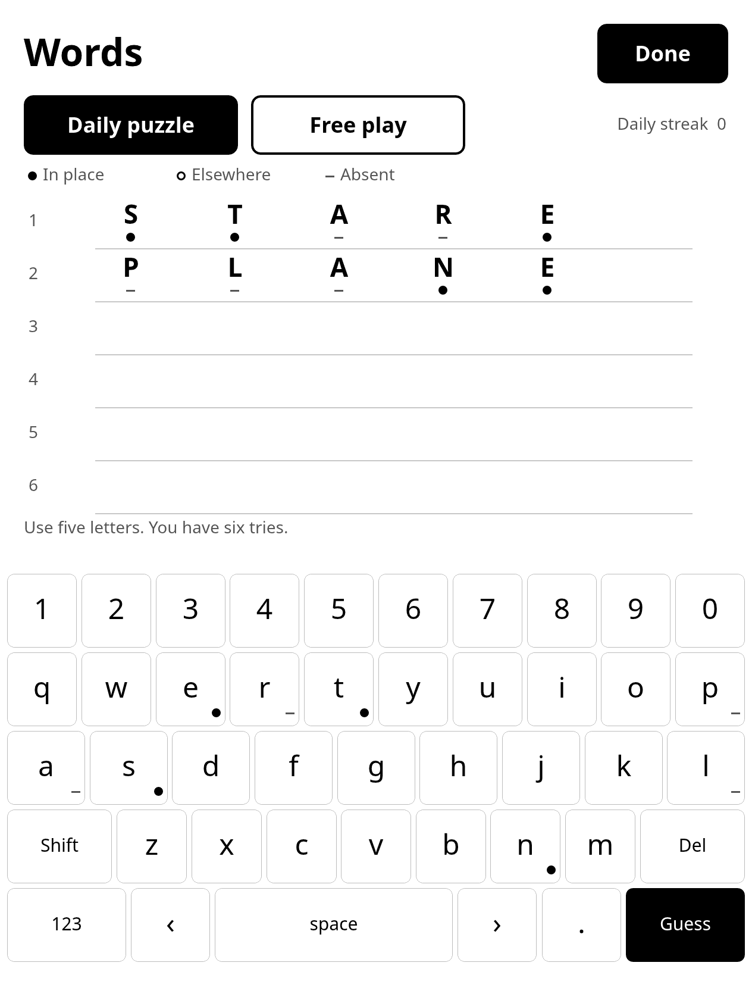

<div align="center">

# Words

**A five-letter word puzzle for Kindle e-readers.**

[Install guide](INSTALL.md) · [Device notes](docs/device-notes.md) · [Changelog](CHANGELOG.md)

</div>

---

Guess a five-letter word in up to six attempts. Each guess marks exact matches, letters in another position, and
letters absent from the answer. Play the daily puzzle or start a separate Free play round.

## Screenshots

<table>
  <tr>
    <td align="center"><br><sub>The daily puzzle</sub></td>
    <td align="center"><br><sub>Dark mode</sub></td>
    <td align="center"><br><sub>Free play solved</sub></td>
  </tr>
</table>

<sub>Desktop simulation at 1264 × 1680 with sample rounds.</sub>

## Highlights

- The daily puzzle changes at midnight UTC, and daily results and streaks are saved separately from Free play.
- The board and keyboard mark letters in black and white.
- A word outside the guess bank leaves the draft and attempt count unchanged.

## Quick start

Copy the `words` and `documents` folders from the local ARMHF package to your Kindle over USB, then eject and open
**Words** from Primitive Launcher. The app uses the fonts installed by Launcher. [Install guide](INSTALL.md)

## Status

Desktop simulation and local ARMHF package checks passed on the Mac. Oasis 3 hardware verification is pending.
[Device notes](docs/device-notes.md)

## Develop locally

Keep `doannt-kindle-tools` and `doannt-kindle-launcher` next to this checkout. The desktop command writes daily puzzle
previews to `build/previews`. The Free play image uses the same renderer with a completed sample round.

```sh
cargo test --offline --locked --workspace
cargo run --offline --locked -p words-desktop -- build/previews
```

## Licence

Copyright (C) 2026 Doan Nguyen.

App code is licensed under PolyForm Noncommercial 1.0.0. [Code license](LICENSE)

Original documentation and screenshots are licensed under Creative Commons Attribution-NonCommercial-ShareAlike 4.0
International (CC BY-NC-SA 4.0). [Documentation and image license](LICENSE-DOCS)

## Word banks

Words uses independently selected English answer and guess banks. KWordle credits both of its English
lists to Sean Patlan, whose source repository describes them as copies of the original game's word lists and provides
no dataset license. [KWordle credits](https://github.com/crizmo/KWordle/blob/a1f2a255ec6a69f7f916dc4e0aa382fbb7f8f742/README.md#credits),
[English list source](https://github.com/seanpatlan/wordle-words).
